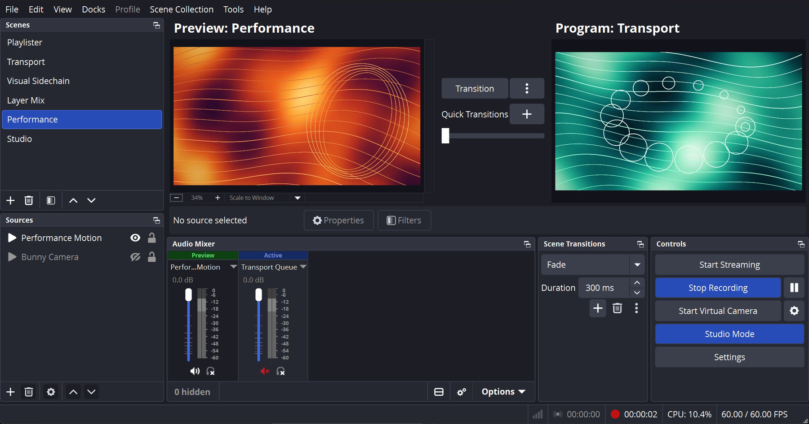

# Playlister

A playlist source for OBS Studio 33 and later. It plays video, audio and image files, folders, playlist files and
web addresses through OBS's own Media Source, one after another, and editing the list does not restart the clip
that is playing.

## Quick start


1. **Install it.** Download the file for your system from the
   [latest release](https://github.com/jbrick2070/obs-playlister/releases/latest), run it (details in
   [Install](#install), just below), then start OBS again.
2. **Add the source.** In OBS, in the **Sources** box, press **+**, choose **Playlister** and press **OK**.
3. **Add what to play.** In the window that opens, press **+** at the right of **Playlist** and choose **Add Files**
   (video, audio, images or a playlist file), **Add Directory** (a folder; new files in it are added by themselves)
   or **Add Path/URL** (a web address). Press **OK**.

That's it. It plays as soon as its scene is in Program. No setting has to be changed: the list loops, folders are
watched, and Playlister tells files, folders, playlist files and web addresses apart by itself.

In Studio Mode a new source waits in the Preview scene: **Status** says "Waiting: plays when its scene is in
Program." until you fade or cut that scene to Program.

Quick start in other languages: [Deutsch](docs/quickstart/de.md#playlister) · [Español](docs/quickstart/es.md#playlister) · [Français](docs/quickstart/fr.md#playlister) · [Italiano](docs/quickstart/it.md#playlister) · [日本語](docs/quickstart/ja.md#playlister) · [한국어](docs/quickstart/ko.md#playlister) · [Nederlands](docs/quickstart/nl.md#playlister) · [Português (Brasil)](docs/quickstart/pt-BR.md#playlister) · [Русский](docs/quickstart/ru.md#playlister) · [Türkçe](docs/quickstart/tr.md#playlister) · [简体中文](docs/quickstart/zh-CN.md#playlister) · [繁體中文](docs/quickstart/zh-TW.md#playlister)

> **Setting up the whole Fadester Suite?** Start with
> **[START-HERE.md](https://github.com/jbrick2070/streamdeck-fadester/blob/main/docs/START-HERE.md)** (what to
> install, which video player to pick, first-run OBS settings, compatibility).



## Install

| System | Needs | Download | First run |
| :--- | :--- | :--- | :--- |
| Windows x64 | OBS 33.0.0 or later | the installer (`.exe`) | It is not code-signed: at "Windows protected your PC" press **More info**, then **Run anyway**. |
| macOS 13.0 or later (Apple Silicon and Intel) | OBS 33.0.0 or later | the `.pkg` | It is not signed by Apple: right-click (or Control-click) the `.pkg`, choose **Open**, then **Open** again. |
| Ubuntu 24.04 (x86_64) | OBS 32.2 or later | the `.deb` | Install it from the release page. |

Linux x86_64 (Ubuntu or Arch, below) needs OBS 32.2 or later: the OBS Project's Ubuntu PPA has 32.2, Arch has 33.

### Other ways to install

#### Windows

- **Zip:** unzip so that you get `C:\ProgramData\obs-studio\plugins\obs-playlister\obs-playlister.dll` and
  `C:\ProgramData\obs-studio\plugins\obs-playlister\data\`. Copying into ProgramData may need administrator rights.
  The zip installs without the "Windows protected your PC" prompt.
- **Portable OBS:** unzip the portable zip into the OBS folder, giving `<OBS folder>\plugins\obs-playlister\`.
- The DLL is unsigned. It loads with Windows' default settings, but it would be refused if Smart App Control or a
  Windows Defender Application Control policy for user-mode code were turned on.

#### macOS

- **Installer:** `obs-playlister-<version>-macos-universal.pkg` installs `obs-playlister.plugin` into
  `~/Library/Application Support/obs-studio/plugins/`.
- **By hand:** unpack `obs-playlister-<version>-macos-universal.tar.xz` and move `obs-playlister.plugin` into
  `~/Library/Application Support/obs-studio/plugins/`.
- One build runs on Apple Silicon and Intel Macs.
- If the `.pkg` will not open, try to open it once, then go to **System Settings → Privacy & Security** and click
  **Open Anyway**. It is not signed or notarized by Apple.
- A folder row that says "access denied" for a folder in Desktop, Documents, Downloads, an external drive or a
  network volume: allow OBS in **System Settings → Privacy & Security → Files and Folders** (or **Full Disk
  Access**) and start OBS again.
- A watched folder on a network volume (SMB, NFS, AFP, WebDAV) is checked on the folder check interval, as macOS
  does not report changes made there by other machines.

> **Mac users, please read.** The macOS build is new. Its tests pass automatically on every change, and on
> 2026-11-17 it was checked in OBS 33.0.1 on an Apple Silicon Mac (M6, macOS 27.3): it loads, a Playlister source
> is created, and OBS quits with 0 memory leaks. The full hands-on test is still to come; please report what you
> find.

#### Linux

- **Ubuntu 24.04:** install the `.deb` from the release page (built against the OBS Project's PPA,
  `ppa:obsproject/obs-studio`).
- **Arch Linux:** build the package from [packaging/arch/PKGBUILD](packaging/arch/PKGBUILD) against Arch's own
  `obs-studio` package:

  ```
  git clone --branch 1.5.0 https://github.com/jbrick2070/obs-playlister.git
  cd obs-playlister/packaging/arch
  makepkg -si
  ```

  It installs `/usr/lib/obs-plugins/obs-playlister.so` and `/usr/share/obs/obs-plugins/obs-playlister/`. Without
  makepkg, the same build is `cmake -S . -B build -G Ninja -DCMAKE_BUILD_TYPE=RelWithDebInfo
  -DCMAKE_INSTALL_PREFIX=/usr -DCMAKE_INSTALL_LIBDIR=lib -DCMAKE_COMPILE_WARNING_AS_ERROR=OFF`, then
  `cmake --build build` and `sudo cmake --install build` (needs `cmake`, `ninja`, `simde` and `curl`).
- The Flatpak OBS is not supported.
- A watched folder on a network drive (NFS, SMB, CIFS) or a FUSE file system is checked on the folder check
  interval, as Linux does not report changes made there by other machines.

## Status lines

Under the playlist, **Status** has one line per row: its number, its kind (**file**, **folder**, **playlist** for
an .m3u, .m3u8 or .pls list, or **web address**) and how it is doing.

```
1: folder - 12 files
2: file
3: file clip-07.mp4 - could not be played (missing, moved, or not a format OBS can play); skipped
4: web address - reading
```

| Status says | What it means, what to do |
| :--- | :--- |
| `reading` | Not read yet; after 5 seconds it adds that the drive is slow to answer. |
| `12 files`, `5 of 40 files`, `8 items` | What the row plays. `5 of 40` when only the newest play. A playlist or web address counts items. |
| `no files yet; new files are added as they arrive` | The folder is empty for now. |
| `no files here yet; files in subfolders need Include subfolders` | Tick **Include subfolders** (advanced options). |
| `no files of the types to play (see File types)` | Check **File types** (advanced options). |
| `waiting for 2 files to finish writing` | They join once written. |
| `3 changes waiting` | **Freeze the list during playback** is on (see [Options](#options)). |
| `1 file could not be played (clip-07.mp4)` | Names the first three such files; they are skipped. |
| `could not be played (missing, moved, or not a format OBS can play)` | It ended before anything played. Skipped; the next item plays. |
| `took too long to start (slow drive or address)` | Nothing played within 5 seconds (15 seconds for an address or a file on a network share). Skipped. |
| an error, such as `folder not found, or not a folder; checking again every 10 s` | It says what happens next. |
| `using the list read at <date and time>` | The list cannot be read now; the last good one keeps playing. |
| `37 items to play` (after the rows) | With more than one row: what the list plays as it stands (a `5 of 40 files` folder counts 5; failed items do not count). Left out while a row is still being read, cannot be read, or plays the last list it could read. |
| a last line that nothing can play | Playback stops. Fix the rows marked above it, or select the source and press Play in the source toolbar under the preview. |
| `Waiting: plays when its scene is in Program.` | The list is fine; the source is simply not on air. |
| `new; press Refresh for its status` | A row you just added. |

- With no rows, Status tells you to press **+** at the right of Playlist.
- Status shows as a warning or an error when one of its lines needs attention. Nothing is drawn over the picture.
- Status follows the list as you edit it, but what plays is not pushed into the open window: press **Refresh**,
  right under Status, to update Status, Now playing, Next and the Play item list.
- The OBS log shows each change as it happens: **Help > Log Files > View Current Log**, lines starting with
  `[obs-playlister]`.

## Options

Changes in the Properties window go live at once; there is no Cancel that protects the output. Changing Speed or
hardware decoding restarts the item that is playing. Removing or changing the row that plays starts another item.

| Option | Default | What it does |
| :--- | :--- | :--- |
| **Playlist** | | The rows. Press **+** to add files, a folder or a web address. |
| **Status** and **Refresh** | | See [Status lines](#status-lines). |
| **Loop playlist** | on | After the last item, start again at the first. |
| **Shuffle** | off | Play in a random order. Adding or removing items does not shuffle again. |
| **Now playing** and **Next** | | What plays and what follows. With Shuffle on, the next item is chosen only when it starts, so Next says so. |
| **Play item** and **Play now** | | Jump to any item of the list. |

Tick **Show advanced options** for the rest:

| Option | Default | What it does |
| :--- | :--- | :--- |
| **When not in Program** | stop, start again when it returns | What the source does while its scene is not on air or the source is hidden in it. Or: play the next item when it returns, pause and continue, or keep playing. |
| **Restart goes to** | the start of the current item | Or the first item in the list. With the default above, this also decides what plays each time the source returns to Program. |
| **Use hardware decoding when available** | on | Decode on the graphics card. |
| **Close the file when not in Program** | off | So the file can be replaced meanwhile. |
| **Speed** | 100% (1x) | 1% to 200% (0.01x to 2x). Changing it restarts the item that is playing. |

**Folders and playlist files**, shared by every folder, playlist and web address row of the source:

| Option | Default | What it does |
| :--- | :--- | :--- |
| **Include subfolders** | off | |
| **File types** | empty | File extensions, separated by spaces. Folders play only these. Empty means all the usual video, audio and image types. |
| **Order** | Oldest first | Name, A to Z; Name, Z to A; Oldest first; Newest first; As listed; As listed, reversed. Oldest and Newest go by the date a file was last changed, as the Directory Sorter script played a folder; a playlist file has no dates and plays in its own order. |
| **Play** | All files | Or Only the newest file, or Only the newest files with **How many** (5). |
| **Still image duration** | 10 s | How long a still image stays on screen. |
| **Check folders again on a timer** and **Time between folder checks** | on, 10 s | New files also arrive where the system does not report changes, such as some network shares. Playlist files on this computer are read again on the same timer when they change. |
| **Time between web list checks** | 300 s | How often a list on the web is downloaded again. |
| **Freeze the list during playback** | off | New, changed and removed files wait until the next Play or Restart, or until you press **Apply waiting changes**. They also join when the source returns to Program, if it is set to start again or to play the next item. Status counts them (`3 changes waiting`); after a press of the button it says that they are being applied, or that none were waiting, and **Refresh** shows the list as it is then. |

Web lists with a user name and password, other character sets and proxies: see
[docs/WEB-LISTS.md](docs/WEB-LISTS.md).

## Hotkeys

Hotkeys: OBS **Settings > Hotkeys**, under this source's name. They work only while the source is shown.

- Each Playlister source has Play/Pause, Restart, Stop, Next and Previous.
- "Shown" means visible anywhere in OBS: in Program, in the Studio Mode Preview, in a projector, or in the source's
  own Properties window, as with OBS's own Media Source.
- A press while the source is not shown does nothing and leaves a line in the OBS log. The buttons of the source
  toolbar and a controller work on a hidden source too.

## Languages

Playlister follows the language OBS runs in (**Settings > General > Language**; OBS needs a restart to change it).
Besides English it speaks Simplified Chinese, Spanish, Brazilian Portuguese, Russian, Japanese, German, French,
Italian, Korean, Traditional Chinese, Turkish and Dutch.

Where OBS itself already translates a string, Playlister starts from OBS's own translation. The rest was drafted by
an AI model (Claude), and the texts up to 0.5.2 were reviewed by a second one (Gemini), whose corrections were
taken; the Italian file and the texts changed since have had no second review. No native speaker has checked any
of it yet. If something reads wrong in your language, please open an issue or a pull request: the files are in
`data/locale/`, one per language, and `en-US.ini` is the English source.

## Limitations

- The Properties window cannot update Now playing and Next by itself when an item ends, because that can crash OBS
  while the window is open. Press Refresh or reopen the window. A controller can show it live (see
  [For controllers and scripts](#for-controllers-and-scripts)).
- With Shuffle on, the next item is not known before it starts.
- No audio track or subtitle selection.
- Folders play in this source only. The Directory Sorter script could also fill a VLC Video Source or an Image
  Slideshow; Playlister does not.
- Windows will not rename or delete a file while it plays (OBS holds it open); do that after it has played.

## Where Playlister comes from

Playlister is a third-party plugin for OBS Studio. It is not made, endorsed or supported by the OBS Project.

**If you use Media Playlist Source or the Directory Sorter for OBS script (both by Ian Rodriguez, CodeYan01 on
GitHub), this is the one tool that does both jobs.**

- It is a fork of [Media Playlist Source](https://github.com/CodeYan01/media-playlist-source). It keeps: editing
  the playlist without restarting the video, even if rows are reordered; remembering the current item across an
  OBS restart; playing a chosen item; and the shuffle based on VLC 4's (adding or removing items does not
  reshuffle, Previous still works after you pick an item, and it reshuffles at the end of a pass without losing
  history).
- Its watched folders take over what the
  [Directory Sorter for OBS](https://github.com/CodeYan01/directory_sorter_for_obs) script did for a playlist:
  sorted folders that update themselves (by date modified, oldest first, by default), with no Stop needed. That
  part is written from scratch.
- It is its own source type and installs next to Media Playlist Source, whose sources are left as they are.
- Unlike the script it needs no Python, and it runs on macOS and Linux too.
- Before 0.3.1 its name began with "OBS"; its plugin files, source ID and this repository keep the identifier
  `obs-playlister`, so existing scenes, settings and hotkeys carry over.

In the Fadester suite four tools play video at adjustable speeds; which one to use when is in
[START-HERE.md](https://github.com/jbrick2070/streamdeck-fadester/blob/main/docs/START-HERE.md). Playlister is the
one for ordered lists of files, folders, playlists and stream addresses; its Speed is a setting that restarts the
item, not a live control.

What changed in each version: [CHANGELOG.md](CHANGELOG.md). The design: [PLAN.md](PLAN.md) and
[REQUIREMENTS.md](REQUIREMENTS.md).

## For controllers and scripts

What a source plays now and what comes next can be read without the Properties window, so a controller key can
show it; only names are published, never paths. Playlister registers the obs-websocket vendor `obs-playlister`
(request `get_now_next`, event `now_next_changed`), and each source has the proc `get_now_next`, the signal
`playlister_now_next` and the proc `select_index`. Every field and an example: [docs/CONTROLLERS.md](docs/CONTROLLERS.md).

## Building

Windows, macOS and Linux build steps and how to run the tests: [docs/BUILDING.md](docs/BUILDING.md).

## License and credits

GPL-2.0-or-later (see [LICENSE](LICENSE)).

- Media Playlist Source: Copyright (C) 2023 Ian Rodriguez. This project keeps his notices; his original project is
  at https://github.com/CodeYan01/media-playlist-source.
- The shuffler is based on VLC's playlist randomizer.
- obs-playlister changes: Copyright (C) 2026 Jeffrey A. Brick. Much of this code was written with an AI coding
  assistant (Claude, by Anthropic); every change is reviewed and tested before release, and the commits that used
  it say so.
- The folder watching (Phase 2, in 0.3.0) is written from scratch. It takes over the job of the Directory Sorter
  for OBS script by Ian Rodriguez (https://github.com/CodeYan01/directory_sorter_for_obs) but uses none of its
  code, as that script has no license.
- The build system and CI come from the OBS Plugin Template, https://github.com/obsproject/obs-plugintemplate (see
  PLUGIN-TEMPLATE.md).
