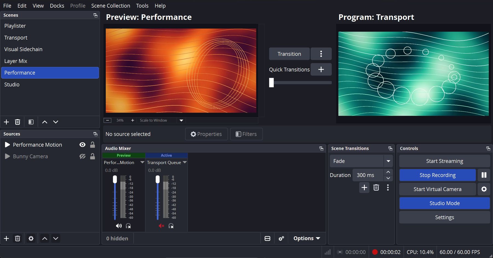

# Playlister

A playlist source for OBS Studio 33 and later. It plays video, audio and image
files, folders, playlist files and web addresses through OBS's own Media Source,
one after another, and editing the list does not restart the clip that is
playing.



## Quick start

1. Install Playlister (see [Install](#install) below). Start OBS again.
2. In OBS, under **Sources**, press **+** and choose **Playlister**. Give it a
   name and press **OK**.
3. In the window that opens, press **+** next to **Playlist**.
4. Choose **Add Files** for video, audio, image or playlist files. Choose
   **Add Directory** for a folder: Playlister plays its files and follows
   changes in it. Choose **Add Path/URL** for a web address.
5. Press **OK**. When the scene is live (in Program), the first item plays. The
   others follow in order.

No setting has to be changed: Loop Playlist is on, folders are watched, and
Playlister finds out by itself whether a row is a file, a folder, a playlist
file or a web address.

Playlister is a third-party plugin for OBS Studio. It is not made, endorsed or
supported by the OBS Project. Before 0.3.1 its name began with "OBS"; its
plugin files, source ID and this repository keep the identifier
`obs-playlister`, so existing scenes, settings and hotkeys carry over.

**If you use Media Playlist Source or the Directory Sorter for OBS script (both
by Ian Rodriguez, CodeYan01 on GitHub), this is the one tool that does both
jobs.** Playlister is a fork of
[Media Playlist Source](https://github.com/CodeYan01/media-playlist-source), and
its watched folders take over what the
[Directory Sorter for OBS](https://github.com/CodeYan01/directory_sorter_for_obs)
script did for a playlist: sorted folders that update themselves (by date
modified, oldest first, by default), with no Stop needed. That part is written
from scratch, and folders play in Playlister itself (the script could also
fill a VLC Video Source or an Image Slideshow). Playlister is its
own source type and installs next to Media Playlist Source without either one
replacing the other; existing Media Playlist Source sources are left as they
are. It also runs on Linux. What changed in each version is in
[CHANGELOG.md](CHANGELOG.md); the design is in [PLAN.md](PLAN.md) and
[REQUIREMENTS.md](REQUIREMENTS.md).

**Bonus: no Python runtime needed.** The Directory Sorter script runs in OBS's
Python scripting, which needs a matching Python installed and set in
Tools > Scripts > Python Settings. Playlister is a native plugin, so there
is nothing else to install or configure.

## Status lines

Under the playlist, **Status** has one line for each row of the list: its
number, its kind and how it is doing. For example:

```
1: folder - 12 files
2: file
3: file - could not be played: it did not start
4: web address - scanning
```

- The kinds are **file**, **URL** (a stream or media address that plays
  directly), **folder**, **playlist** (an .m3u, .m3u8 or .pls list) and
  **web address** (an http or https address that Playlister reads to find out
  whether it is a list).
- A folder, playlist or web address row says `scanning` until it is first
  read, then `empty`, `12 files`, or `5 of 40 files` when only the newest files
  play. It can add: `waiting for 2 files to finish writing`, `3 changes waiting`
  (see Hold changes until the next Play below), `1 file could not be played`,
  an error such as `folder not found, or not a folder`, and
  `showing the last list, from <date and time>` when the list cannot be read
  now and Playlister keeps playing the last good one.
- A file or URL row that failed says why: `it did not start` (it ended before
  anything played) or `it took too long to start` (nothing played within
  5 seconds, or 15 seconds for a URL or a file on a network share). Playlister
  skips it and plays the next item.
- When nothing in the list can play, a last line says so and playback stops.
  Fix or remove the failing rows, or press Play in the OBS media controls to
  try them again.
- With no rows, Status tells you to press **+** next to Playlist.
- Status is shown as a warning or an error when one of its lines needs
  attention.

Status, Current File and Select File do not update by themselves. Press
**Refresh** (or open the window again) to see what is happening now. The OBS
log shows each change as it happens.

## Options

Every change in the Properties window takes effect at once, also while you are
live. Changing Speed or hardware decoding starts the playing clip again from its
beginning. Removing or changing the row that plays starts another clip.

- **Loop Playlist** (on): after the last item, start again at the first.
- **Shuffle** (off): play in a random order. Adding or removing items does not
  shuffle again.
- **Visibility behavior**: what happens when the source is hidden and shown
  again. By default it stops when not visible and restarts when visible.
- **A restart plays**: what Restart plays, the current file again from its
  beginning (default) or the first file in the list. With the default
  Visibility behavior this also decides what plays each time the source is
  shown again.
- **Use hardware decoding when available** (on): decode on the graphics card.
- **Close file when inactive** (off): close the file while the source is not
  shown on the stream or recording.
- **Playlist**: the rows. Press **+** to add files, a folder or a web address.
- **Folder and playlist options**, shared by every folder, playlist and web
  address row of the source:
  - **Include subfolders** (off).
  - **File types to play**: file extensions, separated by spaces. Folder rows
    play only these.
  - **Sort by** (Date modified, Name or Folder order) and **Descending**
    (off). By default the oldest file plays first.
  - **Files to play**: All files, Newest file only, or The newest files, with
    **How many newest files** (5).
  - **Still image duration** (10 s): how long a still image stays on screen.
  - **Check folders again on a timer** (on) and **Time between folder checks**
    (10 s): new files also arrive where the system does not report changes,
    such as some network shares. Playlist files on this computer are read again on
    the same timer when they change.
  - **Time between web list checks** (300 s): how often a list on the web is
    downloaded again.
  - **Hold changes until the next Play** (off): when on, changes found in
    folders and playlists wait until the next Play or Restart, or until you
    press **Apply waiting changes now**. They also join when the source is
    shown again, if its Visibility behavior restarts it or plays the next
    item.
- **Current File** and **Refresh**: what was playing when the window opened or
  when Refresh was last pressed.
- **Select File** and **Play Selected File**: jump to any item of the list.
- **Speed** (100%): playback speed.

## Hotkeys

Hotkeys: set them in OBS Settings, Hotkeys, under the name of this source. They
work only while the source is shown.

Each Playlister source has Play/Pause, Restart, Stop, Next and Previous.
"Shown" means visible anywhere in OBS: in Program, in the Studio Mode preview,
in a projector, or in the source's own Properties window. So a hotkey that
works while the Properties window is open does nothing once the source is
hidden.

## Features (from Media Playlist Source)

- Edit the playlist without restarting the video, even if files are reordered.
- Most settings can be changed while a clip plays. Changing Speed or hardware
  decoding starts the clip again from its beginning.
- Remembers the current file, so it plays again when OBS restarts.
- Play a chosen file or folder item from the list.
- Shuffle (based on VLC 4's implementation): adding or removing items does not
  reshuffle, Previous still works after you pick a file, and it reshuffles at
  the end of a pass without losing history.
- Shows the current file in the Properties window.
- A restart plays the current file again, or the first file in the list.
- Uses hardware (GPU) decoding when available, on by default.

## Install

Requires OBS Studio 33.0.0 or later on Windows x64, and OBS Studio 32.2 or later on Linux x86_64 (the OBS
Project's Ubuntu PPA has 32.2, Arch has 33). Older OBS versions on Windows do not load this layout. After
installing, start OBS again and follow the [Quick start](#quick-start).

### Windows

- **Zip:** unzip so that you get
  `C:\ProgramData\obs-studio\plugins\obs-playlister\obs-playlister.dll` and
  `C:\ProgramData\obs-studio\plugins\obs-playlister\data\`. Copying into
  ProgramData may need administrator rights.
- **Portable OBS:** unzip the portable zip into the OBS folder, giving
  `<OBS folder>\plugins\obs-playlister\`.
- **Installer:** run the `.exe`. It is not code-signed, so Windows SmartScreen
  shows "Windows protected your PC / Unknown publisher"; choose
  **More info, then Run anyway**. The zip installs without that prompt.

The DLL is unsigned. It loads with Windows' default settings, but it would be
refused if Smart App Control or a Windows Defender Application Control policy
for user-mode code were turned on.

### Linux

- **Arch Linux:** build the package from
  [packaging/arch/PKGBUILD](packaging/arch/PKGBUILD) against Arch's own
  `obs-studio` package:

  ```
  git clone --branch 0.5.0 https://github.com/jbrick2070/obs-playlister.git
  cd obs-playlister/packaging/arch
  makepkg -si
  ```

  It installs `/usr/lib/obs-plugins/obs-playlister.so` and
  `/usr/share/obs/obs-plugins/obs-playlister/`. Without makepkg, the same build
  is `cmake -S . -B build -G Ninja -DCMAKE_BUILD_TYPE=RelWithDebInfo
  -DCMAKE_INSTALL_PREFIX=/usr -DCMAKE_INSTALL_LIBDIR=lib
  -DCMAKE_COMPILE_WARNING_AS_ERROR=OFF`, then `cmake --build build` and
  `sudo cmake --install build` (needs `cmake`, `ninja`, `simde` and `curl`).
- **Ubuntu 24.04:** install the `.deb` from the release page (built against
  the OBS Project's PPA, `ppa:obsproject/obs-studio`).
- The Flatpak OBS is not supported.

On Linux, a watched folder on a network drive (NFS, SMB, CIFS) or a FUSE file
system is checked on the folder check interval, as Linux does not report
changes made there by other machines.

## Languages

Playlister follows the language OBS runs in (Settings > General > Language;
OBS needs a restart to change it). Besides English it speaks Simplified
Chinese, Spanish, Brazilian Portuguese, Russian, Japanese, German, French,
Korean, Traditional Chinese, Turkish and Dutch. Where OBS itself already translates
a string, Playlister starts from OBS's own translation. The rest was drafted
by an AI model (Claude), and every file was reviewed by a second one (Gemini),
whose corrections were taken; no native speaker has checked it yet. If something reads wrong in your language, please open an
issue or a pull request: the files are in `data/locale/`, one per language,
and `en-US.ini` is the English source.

## Limitations

- The Properties window shows the current file, but it cannot update by itself
  when a video ends, because that can crash OBS while the window is open.
  Reopen the window or press Refresh.
- No audio track or subtitle selection.
- Folders play in this source only. The Directory Sorter script could also
  fill a VLC Video Source or an Image Slideshow; Playlister does not.
- Windows will not rename or delete a file while it plays (OBS holds it open);
  do that after it has played.

## For developers

The source id is `obs_playlister_source`. To see the setting keys, use
[obs_data_get_json](https://docs.obsproject.com/reference-settings#c.obs_data_get_json)
on the source's settings or look at the scene collection JSON.

To select a file from a script or another plugin:

```c
proc_handler_t *ph = obs_source_get_proc_handler(source);
struct calldata cd = {0};
calldata_set_int(&cd, "media_index", 3);       // 4th row of the playlist
calldata_set_int(&cd, "folder_item_index", 3); // 4th item of that row if it is a folder
proc_handler_call(ph, "select_index", &cd);
calldata_free(&cd);
```

- `media_index`: 0-based row in the playlist. If it is past the end of the
  list, the call does nothing (the original README said it falls back to 0; the
  code never did).
- `folder_item_index`: 0-based item in the folder at `media_index`. If it is
  past the end of the folder, item 0 is played. It is ignored for rows that are
  not folders.

## Building

Windows 11 x64 with Visual Studio 2022 (or newer) C++ build tools, Windows SDK
10.0.26100 and CMake 3.28 or newer. From the repository root:

```
cmake --preset windows-x64
cmake --build --preset windows-x64 --config RelWithDebInfo
ctest --test-dir build_x64 -C RelWithDebInfo --output-on-failure --no-tests=error
cmake --install build_x64 --config RelWithDebInfo --prefix release/RelWithDebInfo
```

The first configure downloads the OBS 33.0.0 source and the matching obs-deps
into `.deps/` and builds libobs once. Manual OBS checks are listed in
[TESTING.md](TESTING.md).

On Linux the build uses the installed OBS (its development files) instead:
`obs-studio`, `cmake`, `ninja`, `simde` and libcurl's development files
(`libcurl4-openssl-dev` on Ubuntu). From the repository root:

```
cmake -S . -B build -G Ninja -DCMAKE_BUILD_TYPE=RelWithDebInfo -DCMAKE_COMPILE_WARNING_AS_ERROR=OFF
cmake --build build
ctest --test-dir build --output-on-failure --no-tests=error
```

## License and credits

GPL-2.0-or-later (see [LICENSE](LICENSE)).

- Media Playlist Source: Copyright (C) 2023 Ian Rodriguez. This project keeps
  his notices; his original project is at
  https://github.com/CodeYan01/media-playlist-source.
- The shuffler is based on VLC's playlist randomizer.
- obs-playlister changes: Copyright (C) 2026 Jeffrey A. Brick. Much of this
  code was written with an AI coding assistant (Claude, by Anthropic); every
  change is reviewed and tested before release, and the commits that used it
  say so.
- The folder watching (Phase 2, in 0.3.0) is written from scratch. It takes
  over the job of the Directory Sorter for OBS script by Ian Rodriguez
  (https://github.com/CodeYan01/directory_sorter_for_obs) but uses none of its
  code, as that script has no license.
- The build system and CI come from the OBS Plugin Template,
  https://github.com/obsproject/obs-plugintemplate (see PLUGIN-TEMPLATE.md).
