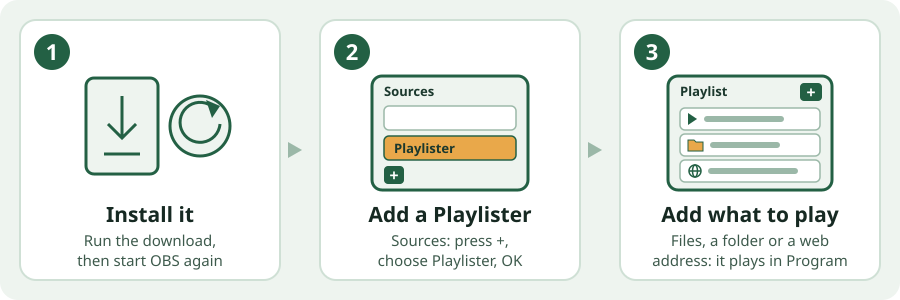

> Ceci est une traduction du démarrage rapide anglais, faite avec un modèle d'IA et vérifiée par un second modèle ; aucun locuteur natif ne l'a encore relue.

# Playlister

Une source de liste de lecture pour OBS Studio 33 et versions ultérieures. Elle lit des fichiers vidéo, audio et image, des dossiers, des fichiers de liste de lecture et des adresses web, l'un après l'autre, et modifier la liste ne redémarre pas le clip en cours.

1. **Installez-le.** Téléchargez le fichier pour votre système depuis la [dernière version](https://github.com/jbrick2070/obs-playlister/releases/latest), lancez-le (détails dans [Install](../../README.md#install), en anglais), puis redémarrez OBS.
2. **Ajoutez la source.** Dans OBS, dans le panneau **Sources**, cliquez sur **+**, choisissez **Playlister** et cliquez sur **Ok**.
3. **Ajoutez ce que vous voulez lire.** Dans la fenêtre qui s'ouvre, cliquez sur **+** à droite de **Liste de lecture** et choisissez **Ajouter des fichiers** (vidéo, audio, images ou un fichier de liste de lecture), **Ajouter un répertoire** (un dossier ; les nouveaux fichiers y sont ajoutés tout seuls) ou **Ajouter un chemin/URL** (une adresse web). Cliquez sur **Ok**.

C'est tout. La lecture démarre dès que sa scène est dans le **Programme**. Aucun réglage à changer : la liste tourne en boucle, les dossiers sont surveillés et Playlister reconnaît seul un fichier, un dossier, un fichier de liste de lecture ou une adresse web.

En **Mode studio**, une nouvelle source attend dans la scène d'**Aperçu** : **État** indique « En attente : la lecture démarre quand sa scène est dans le Programme. » jusqu'à ce que vous passiez cette scène au **Programme** avec **Fondu** ou **Coupure**.

[Guide complet (en anglais)](../../README.md)
